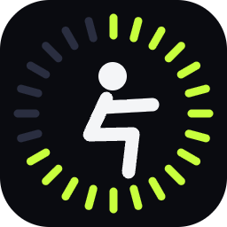
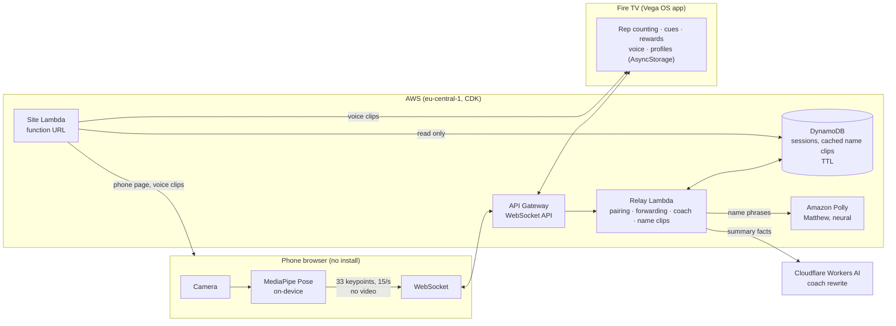

<p align="center"></p>

# Spotter

**Your phone is the camera. Your TV is the coach.**

Spotter is AI form coaching for Fire TV. Lean your phone against something across the room, scan the code on the TV, and work out: the TV counts every rep, says when one doesn't count ("Go deeper"), cheers you on by name, and sums up the set with a coach's advice for next time. No account, no app to install on the phone, and no video ever leaves it.

Built for the Amazon "Build, Ship, Shape" Developer Hackathon: **Fire TV track (Vega OS)** + **AWS Builder**.

**Live on the Amazon Appstore** for Vega Fire TVs (version 1.0.0, published 2026-10-07).

## What it does

- **Pair in one scan.** The TV shows a QR code and a 6-character code. The phone opens a web page, no install, and starts its camera.
- **Trains like a coach: sets, reps and rest.** Squats 3 × 12, lunges 3 × 10, jumping jacks 3 × 20, with a rest countdown between sets ("Great set! Take a breather.", "Set two. Let's go!"), Skip rest, and a rest time each player can choose. A clean, complete workout adds 2 reps per set next time. The phone shows the set and the rest countdown too.
- **Counts reps live** for squats, lunges and jumping jacks, from on-phone pose tracking (MediaPipe). A rep only counts at full depth; half reps get a "Go deeper" cue.
- **Talks to you.** An Amazon Polly voice counts reps, cues form, and calls you by name ("Let's go, Ramy!", "Last one, Ramy!"), on the TV or on the phone.
- **Celebrates.** Streaks, a new deepest rep and hitting your target get a burst, a badge and a funny cartoon sticker for the exercise, and the ring around the count fills tick by tick with each rep. Every finished set ends with a sticker too.
- **Coaches after the set.** A rule-based summary (pace, depth, clean reps, a target for next time), optionally rewritten by an AI model that is not allowed to invent numbers.
- **Remembers you, without an account.** Up to 4 players per TV, each with a name and their progress, saved on the TV only.

## Architecture



**How a session flows**

1. The TV app opens the WebSocket and asks to host. The relay creates a session with a 6-character code (DynamoDB, 2-hour TTL).
2. The phone opens the page from the QR code and joins with the code. Pose tracking runs on the phone; only keypoints `[x, y, visibility]` are sent, 15 times a second.
3. The relay forwards each frame to the paired TV. A warm Lambda caches the route, so frames skip DynamoDB.
4. The TV counts reps from smoothed joint angles, shows cues and rewards, and speaks through Vega's media player (falling back to the phone's speaker if TV audio fails).
5. On Finish, the TV shows its rule-based summary at once, then asks the relay for an AI rewrite. The rewrite is used only if it passes validation: same numbers, no invented facts, no off-topic advice.

**Why it's built this way**

| Decision | Reason |
|---|---|
| Pose tracking on the phone, keypoints only | Privacy (no video leaves the phone) and a tiny, cheap stream (about 1 KB a frame) |
| API Gateway WebSocket + Lambda + DynamoDB | Serverless, pay per use, no server to keep alive for a living-room app |
| Rule-based coach first, AI rewrite second | The numbers are always right; the AI only improves the wording |
| Name clips made once with Polly and cached | 5 clips per name; the public URL only serves clips, it can never trigger Polly |
| Profiles in Vega AsyncStorage | No account and no personal data in the cloud |
| Site served from a Lambda function URL | CloudFront isn't available on this account yet |
| AI coach on Cloudflare Workers AI | Amazon Bedrock is blocked on this account (support case open); switching is one setting (`COACH_PROVIDER`) |

## Security and cost limits

- Pairing codes use an unambiguous 31-character alphabet and expire. A phone can only join a session that has no phone yet.
- Every message is validated in `infra/lambda/pairing.mjs`: frame shape and size, clip ids, names (one word, 16 characters at most, no control characters).
- Only a TV can ask for coaching (once per 10 s) or name clips (once per 10 s, at most 250 clips a day in total). Only a phone can send a name, and only to its own TV.
- The relay and the AI Worker share a secret (SSM SecureString / Worker secret), compared in constant time.
- The WebSocket stage is throttled (200 requests/s, burst 400).

## Measured

| What | Result | Setup |
|---|---|---|
| Pose tracking on the phone | 48 fps | iPhone 13, Safari |
| Phone → TV latency through the relay | 88 ms median, 169 ms p95 | `infra/e2e.mjs`, live stack |
| Making a name's 5 voice clips | about 2 s, once per name | `infra/e2e-voice-name.mjs` |
| Tests | 101 TV (Jest), 23 relay (`node --test`), 4 end-to-end scripts | |

## Repository

| Path | What |
|---|---|
| `tv-app/` | Vega OS (React Native) Fire TV app. Exercise detection in `src/exercises/`, screens in `src/screens/`. |
| `phone-web/index.html` | The phone camera page (single file, MediaPipe from a CDN) |
| `infra/` | AWS CDK stack (`stack.ts`), Lambdas (`lambda/`, `site/`), end-to-end scripts (`e2e*.mjs`), simulated phone and TV |
| `coach-worker/` | Cloudflare Worker for the AI coach rewrite |
| `voice/` | Coach phrases (`phrases.json`) and the Polly clip generator |
| `reward-art/` | Prompts and a local Workers AI helper that made the reward stickers (reviewed by hand, then bundled in `tv-app/assets/rewards/`) |
| `docs/design-system.md` | The "Arena" design system |
| `brand/` | The logo (SVG sources), the PNG renders, and the store images |
| `docs/friction-log.md` | Friction we hit with Vega and AWS, for the hackathon feedback |
| `spikes/` | Early experiments (local dev relay) |

## Run it

Requirements: Node 22, the [Vega SDK](https://developer.amazon.com/docs/vega/latest/install-vega-sdk.html), an AWS account (for the relay), and a phone.

```bash
# 1. Cloud relay and phone page (prints RelayUrl and PhoneUrl)
cd infra
npm install
aws ssm put-parameter --name /spotter/coach-worker-secret --type SecureString --value "<random secret>"
npx cdk deploy

# 2. AI coach (optional; without it the TV keeps its rule-based summary)
cd ../coach-worker
npx wrangler secret put COACH_SECRET   # the same secret
npx wrangler deploy

# 3. TV app: put RelayUrl and PhoneUrl in tv-app/src/config.ts
cd ../tv-app
source ~/vega/env
npm install
npm run build:debug
vega virtual-device start
vega run-app build/aarch64-debug/spotter-tv_aarch64.vpkg com.spotter.tv.main -d VirtualDevice
# to update without wiping saved players:
# vega device install-app -p build/aarch64-debug/spotter-tv_aarch64.vpkg -d VirtualDevice
```

Then scan the QR code on the TV with your phone and tap **Start camera**.

**Checks**

```bash
cd tv-app && npx tsc --noEmit -p . && npm run lint && npx jest
cd infra && node --test lambda/
node e2e.mjs <RelayUrl>                      # pairing, forwarding, latency
node e2e-coach.mjs <RelayUrl>                # AI coach and its limits
node e2e-voice-name.mjs <RelayUrl> <PhoneUrl>
node e2e-name-prompt.mjs <RelayUrl>
node e2e-status.mjs <RelayUrl>             # set and rest progress to the phone
```

> The Vega build fails if the project path contains spaces (see `docs/friction-log.md`).

## License

MIT. Fonts (Archivo, DM Sans) are under the SIL Open Font License; see `tv-app/assets/fonts/`.
